 

### `> Who am I...`

Aspiring aerospace engineer driven by curiosity, global experience, and a desire to build practical solutions. I work across mechanical systems, prototyping, robotics, and hardware, and I write code on the side for dashboards, data apps, visualizers, websites, and CLI automation tools.

🎓 UIUC Grainger &nbsp;·&nbsp; 🌏 HKUST exchange (Aug–Dec 2026) &nbsp;·&nbsp; 🗣️ Czech / English / Spanish / German

### `> Stack`

     

    

### `> Stats`

### `> Modules`

<b>🚀 Projects</b>

 

- **AD COSMO**: aerospace platform with a live launch board, webcasts, and a Starship flight-test deep dive
- **EchoSync**: browser music visualizer with beat-reactive effects (Web Audio API)
- **MINDSPACE**: single-file personal dashboard with draggable windows, notes, and a degree tracker
- **SipScore**: energy drink database and health-ranking app (Node, Express, SQLite)
- **Insta Idea Notetaker**: Python script that summarizes shared Instagram reels with the Claude API
- **IMDb Ratings DB**: personal ratings database in SQLite
- **RD Čimelice**: marketing site for new family homes in South Bohemia
- **Personal Hub**: portfolio site (work in progress)

<b>🎮 Fun Facts</b>

 

- Too many half-finished side projects, always one more in progress

### `> Connect`

   

